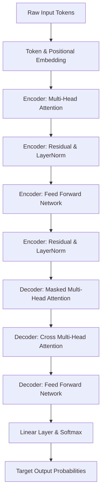

# Research Paper Analysis: Attention Is All You Need

## 1. Paper Metadata
- **Title:** Attention Is All You Need
- **Authors:** Ashish Vaswani, Noam Shazeer, Niki Parmar, Jakob Uszkoreit, Llion Jones, Aidan N. Gomez, Lukasz Kaiser, Illia Polosukhin
- **Publication Venue:** Advances in Neural Information Processing Systems (NeurIPS 2017)
- **Publication Year:** 2017
- **Citation Count:** 120,000+ citations
- **Field Category:** Natural Language Processing / Deep Learning

---

## 2. Core Concept Extraction (<300 Words)
*(Actual Word Count: 123 words)*

### Problem Statement
Traditional sequence transduction models rely on recurrent neural networks (RNNs) or convolutions. RNNs process input sequentially word-by-word, creating an inherent computational bottleneck that prevents parallelization on modern hardware and struggles to retain long-distance contextual relationships.

### Main Methodology
The paper introduces the Transformer architecture, which completely eliminates recurrence and convolutions. Instead, it relies exclusively on self-attention mechanisms to directly model dependencies between all words in a sequence simultaneously, allowing massive parallel GPU processing.

### Key Mathematical or Algorithmic Contributions
- Scaled Dot-Product Attention: Attention(Q, K, V) = softmax((Q * K^T) / sqrt(d_k)) * V
- Multi-Head Attention: Projecting queries, keys, and values into multiple subspaces to attend to information from different representation aspects simultaneously
- Sinusoidal Positional Encoding: Adding fixed sine and cosine wave values to token embeddings to convey word order without sequential recurrence

### Unified Overview
Before this paper, AI sequence models read sentences word-by-word like a person reading out loud, making training slow and memory-intensive. The Transformer revolutionized deep learning by processing whole sentences at once using Self-Attention. Think of self-attention as an automated highlighter that instantly connects related words regardless of distance—such as linking 'it' to 'animal' across a long paragraph. The core formula, Scaled Dot-Product Attention, computes similarity between queries (Q) and keys (K), scales the result to maintain stable gradients, applies softmax to get attention weights, and multiplies by values (V). Multi-Head Attention repeats this process across multiple representation spaces to capture diverse linguistic patterns concurrently. By replacing recurrent loops with attention and sinusoidal positional encodings, the Transformer achieved state-of-the-art translation quality while cutting training time drastically.

---

## 3. Architecture Flowchart (Mermaid.js)

### Architecture Breakdown:
- **Input Data:** Raw text token sequences converted into vector space representation.
- **Main Processing Steps:**
  - Tokenization and word embedding vector lookup
  - Addition of sinusoidal positional encodings
  - Stacking through multi-head attention and position-wise feed-forward networks with residual connections
- **Model Architecture:** Encoder-Decoder structure utilizing exclusively self-attention and cross-attention blocks.
- **Important Components:** Scaled Dot-Product Attention, Multi-Head Attention sub-blocks, Sinusoidal Positional Embeddings, Layer Normalization and Residual Connections
- **Final Output:** Probability distribution over vocabulary for target sequence token prediction.

---

## 4. Future Work & 3rd-Year Student Project Opportunities
*(Student research extensions distinct from original paper results)*

### Idea #1: EdgeTransformer: Dynamic Head Pruning for Low-Latency Inference
- **Improvement / Extension:** Implement dynamic attention-head pruning and 8-bit quantization on a Transformer encoder to speed up inference on lightweight edge devices.
- **Expected Performance Metric:** Retain >= 92% of baseline translation accuracy/BLEU while reducing model parameter size by 40% and achieving 2x lower latency.
- **Recommended Tech Stack:** PyTorch, Hugging Face Transformers, ONNX Runtime, FastAPI
- **Estimated Timeline:** ~6 Weeks
- **Mentor Implementation Tip:** Start with MarianMT or Small BERT, prune attention heads with lowest L1-norm contribution, and convert output models to ONNX runtime.

### Idea #2: Domain-Adapted Lightweight Summarizer for Clinical Notes
- **Improvement / Extension:** Fine-tune a compact Transformer using Parameter-Efficient Fine-Tuning (LoRA) on medical/clinical texts to generate structured summaries.
- **Expected Performance Metric:** Achieve ROUGE-1 score >= 0.45 and ROUGE-L >= 0.40 on clinical dataset benchmarks with zero hallucinated lab numbers.
- **Recommended Tech Stack:** PyTorch, PEFT / LoRA, Hugging Face Datasets, Weights & Biases
- **Estimated Timeline:** ~8 Weeks
- **Mentor Implementation Tip:** Utilize open-source clinical notes from MIMIC-III or PubMed summaries and apply adapter-based fine-tuning to prevent catastrophic forgetting.

### Idea #3: Interactive Real-Time Attention Map Visualizer
- **Improvement / Extension:** Build a web application that extracts and renders multi-head attention weight matrices dynamically as users type sentences.
- **Expected Performance Metric:** Render real-time visual attention heatmaps with latency under 50ms for text inputs up to 256 tokens.
- **Recommended Tech Stack:** React, D3.js, Python, FastAPI, PyTorch
- **Estimated Timeline:** ~6 Weeks
- **Mentor Implementation Tip:** Hook into PyTorch attention weight outputs during model forward pass and stream matrix JSON data directly to D3 SVG heatmap components.

---
*Generated by Advanced Computer Science Research Paper Assistant*
